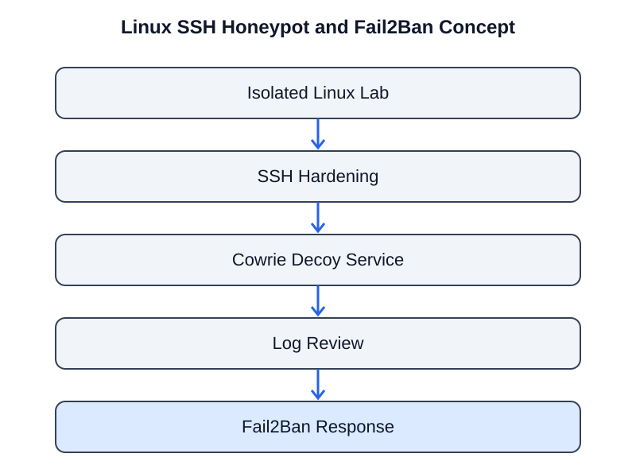

# Linux SSH Protection with Cowrie Honeypot and Fail2Ban

> Defensive Linux lab covering SSH hardening, honeypot-based observation, authentication-log review, and automated blocking with Fail2Ban.

[](#project-overview)
[](#components)
[](#responsible-use)



## Project overview

This repository is organized around a defensive Linux server exercise combining SSH hardening, a Cowrie SSH honeypot, Fail2Ban, authentication-log review, and a project report. The stated goal is to observe SSH brute-force activity, inspect logs, and automatically block abusive sources.

The folders separate setup, honeypot configuration, attack simulation, service hardening, log analysis, and reporting. The detailed Markdown files currently present in those folders are empty placeholders. This README therefore describes the stated project scope and repository structure without inventing commands, configuration values, test counts, or measured outcomes.

## Architecture

```text
Authorized isolated lab
       |
       +--------------------+
       |                    |
       v                    v
 SSH service / host     Cowrie honeypot
       |                    |
       v                    v
 SSH hardening          Session / activity logs
       |                    |
       +----------+---------+
                  |
                  v
           Log review / analysis
                  |
                  v
               Fail2Ban
                  |
                  v
       Temporary source-IP bans
```

This is a conceptual view of the components named in the project description. Confirm actual network bindings, log paths, jail configuration, and enforcement flow against the implementation before presenting it as a deployment diagram.

## Components

| Component | Intended role |
|---|---|
| Cowrie | SSH/Telnet honeypot for observing activity against a decoy service |
| Fail2Ban | Reads configured log sources and applies temporary bans when jail conditions are met |
| SSH hardening | Reduce exposure of the real administrative SSH service |
| Authentication logs | Provide records for reviewing authentication activity |
| Attack simulation | Controlled validation of detection and blocking |
| Report | Summarize setup, observations, and defensive conclusions |

## Repository structure

| Directory | Purpose |
|---|---|
| `setup/` | Kali, Ubuntu, and lab network preparation |
| `honeypot/` | Cowrie installation and configuration notes |
| `attack-simulation/` | Controlled authentication-test notes |
| `ssh-hardening/` | SSH service hardening notes |
| `fail2ban/` | Fail2Ban configuration notes |
| `tcp-wrappers/` | Host access-control notes |
| `logs-analysis/` | Authentication, Cowrie, and Fail2Ban log review |
| `report/` | Final project report |

## Defensive objectives

1. Separate a decoy service from the host's administrative access path.
2. Reduce SSH exposure through secure configuration and access restrictions.
3. Observe authentication attempts in controlled conditions.
4. Review honeypot and system authentication logs for suspicious activity.
5. Use Fail2Ban jails to apply temporary bans according to configured filters and thresholds.
6. Document observations, limitations, and defensive conclusions.

## Validation checklist

- [ ] Confirm the lab network is isolated and all systems are authorized.
- [ ] Record operating-system, Cowrie, and Fail2Ban versions.
- [ ] Document the interfaces and ports used by each service.
- [ ] Verify the real SSH service and honeypot do not unintentionally conflict.
- [ ] Capture sanitized Cowrie session events.
- [ ] Record the relevant Fail2Ban jail, filter, threshold, and ban duration.
- [ ] Verify a controlled test produces the expected log event and ban.
- [ ] Verify the ban expires or is safely removed as configured.
- [ ] Include sanitized log evidence and a concise findings report.

## Security considerations

- Do not expose an experimental honeypot or inadequately hardened host directly to the public internet.
- Keep the decoy environment isolated from production systems and sensitive networks.
- Never reuse real credentials in honeypot simulations.
- Restrict access to logs; they may contain attacker-supplied strings and sensitive metadata.
- Validate Fail2Ban actions carefully to avoid locking out legitimate administrators.
- TCP Wrappers support depends on the distribution and service. Verify that the target system actually uses it.

## Current documentation status

The detailed Markdown files in the project folders are empty placeholders. Add verified setup steps, sanitized commands, configuration excerpts, log examples, and actual observations before presenting the project as fully reproducible.

## Author

**Naga Venkata Eswara Sastry L**  
Cybersecurity learner | Aspiring SOC Analyst
